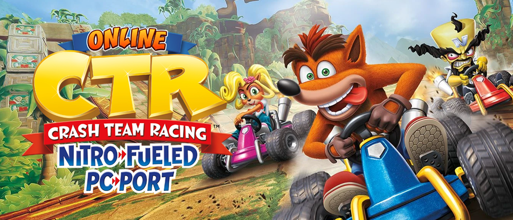

  

# OCTR

**Crash Team Racing: Nitro-Fueled (PS4, CUSA13795 v1.21) running natively on Windows and Linux,
with online play on a community server.**

This is the online fork of
[GetLostIn's CTR-NitroFueled-PC](https://github.com/GetLostIn/CTR-NitroFueled-PC), the Windows
build of [SacredFire](https://github.com/T3CHNOLOG1C/SacredFire), the native Linux port of the
game by T3CHNOLOG1C. The game's own x86-64 code runs directly on the CPU, a small runtime
replaces the PS4 system libraries, and a renderer derived from shadPS4 translates the PS4 GPU
work to Vulkan. The Windows layer (loader, memory, TLS, exceptions, files, timers) comes from
Supermedo's Windows port of bbport; see
[packaging/windows/README.md](packaging/windows/README.md).

On top of that, this fork adds online play: public races, private rooms, groups, friends and the
Pit Stop through the RyuNET server, with your own nickname, Discord account linking and Discord
invites.

> **No game files are included.** You need your own dump of the game and its 1.21 update. Both
> builds of the 1.21 update work: the one for firmware 5.05 (the reference) and the one for
> 6.72+. This project is not affiliated with or endorsed by Sony Interactive Entertainment,
> Activision or Beenox. *Crash Team Racing*, *Nitro-Fueled* and *PlayStation* are trademarks of
> their owners, named here only to identify the game this software runs.

  <a href="#status">Status</a> ·
  <a href="#quick-start">Quick start</a> ·
  <a href="#online">Online</a> ·
  <a href="#which-game-dumps-work">Game dumps</a> ·
  <a href="#settings">Settings</a> ·
  <a href="#known-limitations">Limitations</a> ·
  <a href="#development">Development</a> ·
  <a href="#credits-and-licenses">Credits</a> ·
  <a href="#recent-releases">Releases</a>

## Status

| Platform | Verified on | Result |
| --- | --- | --- |
| Windows | 11 24H2, GeForce RTX 3070, Core i5-9500 | 110–130 FPS uncapped with the 60 FPS patch |
| Linux | Steam Deck, Mesa RADV | Playable; 37–45 FPS with the 60 FPS patch |

That covers menus, Adventure and Arcade, races, sound, cutscenes, Xbox/SDL controllers and
keyboard, saving, the community patches (60 FPS, no motion blur), restart from the in-game menu,
and the game's DLC from your own packages (optional). Internal resolution goes from 480p to native
4K, with AMD FSR 1 or temporal upscaling (AMD FSR 3.1, or NVIDIA DLSS on RTX cards;
experimental). The FPS limit keeps the game at 60 by default and goes up to 240.

Since v0.5.3 the first start prepares the game's shaders for your GPU from your own dump (a few
seconds, once: [shaders/README.md](shaders/README.md)), so new tracks and racers no longer stop
the game to compile them. The few the recipe lacks are compiled when first seen and cached.

Time Trial on recognized USA/EU 1.21 executables credits every challenge beaten by a finish:
N. Tropy, Oxide, Velo and developer times, even with no ghost selected. Times must be strictly
faster; existing progress is kept. Rewards still require completing their required tracks. Other
executable layouts keep the game's original progression.

## Quick start

Both builds need a Vulkan 1.3 GPU and your own dump of the game and its 1.21 update.

### Windows

1. Download `CTR-NitroFueled-PC-portable-<version>-windows.zip` from
   [Releases](https://github.com/Ryu7w7/OCTR-NitroFueled-PC/releases) and unzip it anywhere.
2. Open **`Crash™ Team Racing Nitro-Fueled.exe`** (`CTR-NitroFueled-PC.exe` before v0.5.1). This
   is the launcher.
3. Choose your `CUSA13795` (base game) and `CUSA13795-patch` (update 1.21) folders, press
   *Prepare the game* once, then *Play*. The merge uses hard links, so it takes no extra disk
   space.

Python is bundled.

### Linux and Steam Deck

Download the AppImage from the same Releases page. The v0.5 asset is
`SacredFire-x86_64.AppImage`; automated releases use `SacredFire-<version>-x86_64.AppImage`. Data,
saves and the nickname key live in `~/.local/share/sacredfire`.

Linux releases use the shared Windows/Linux launcher. Updating an older GTK AppImage opens the
native launcher and imports existing preferences; later updates keep using the native launcher.

Steam Deck notes:

- The launcher's **Add to Steam** button (Play tab and Settings) writes the shortcut, with
  `--play` for game mode, while Steam is closed. By hand, *Add a Non-Steam Game* needs no options.
  The compatibility tool does not matter.
- Steam's overlay is removed before the port's own programs start.
- Where Steam runs games without FUSE, set the launch options to
  `TMPDIR=$HOME/.cache APPIMAGE_EXTRACT_AND_RUN=1 NO_CLEANUP=1 %command%`. The AppImage then
  unpacks itself (~1.2 GB, `~/.cache/appimage_extracted_*`) on the first start and reuses that
  copy; `TMPDIR` keeps that out of a RAM-backed `/tmp`. Add ` --play` after `%command%` to skip
  the launcher.
- **NVIDIA:** startup discovers the host's 64-bit NVIDIA Vulkan ICD and exposes its libraries
  next to the bundled AMD/Intel drivers (`BB_NVIDIA_LIB_DIR` when they are not under `/usr/lib*`).
  `--vulkan-info` prints what the package sees.
- MangoHud is bundled (launcher switch) and drawn once even when a system MangoHud or Steam's
  overlay is on.

### Updating

The launcher asks GitHub for the latest release every time it starts, and the line under its
header shows the new version with an **Update** button (**Tools → Check for updates** asks again).
Updating from the launcher keeps every setting and save.

**From the launcher**

- *Windows:* the launcher downloads the release's portable ZIP into `update\`, checks its size and
  SHA-256, unpacks it over the folder and restarts itself. Your files are never written: `user\`,
  `bbport.ini`, `launcher.ini` and `ryunet_online.key` stay as they are. Every file it replaces is
  moved aside first, so a failed or interrupted update is rolled back and the folder keeps
  working. Close the game first (the launcher refuses to update while it runs). With the
  automatic install on (Settings, off by default) the update starts by itself; otherwise press
  the button.
- *Linux:* the new AppImage is downloaded next to the running one as a `.part` file, checked
  against the size and SHA-256 of the release, made executable and put in place of the running
  AppImage — same path and name, so desktop entries and the Steam shortcut
  (`~/.local/share/sacredfire/SacredFire.AppImage`) keep working — then the launcher restarts
  itself. A failed download leaves the current AppImage untouched. From a source checkout or a
  Nix build the button opens the release page instead.

**Manual**

- *Windows:* unzip the new `CTR-NitroFueled-PC-portable-<version>-windows.zip` over your folder;
  the player files listed above are not in the ZIP, so they survive. Updating into a different
  folder means copying `user\`, `bbport.ini`, `launcher.ini` and `ryunet_online.key` across.
- *Linux:* download the release AppImage, `chmod +x` it and replace the AppImage you run, in the
  same path (a Steam shortcut points at `~/.local/share/sacredfire/SacredFire.AppImage`). Saves,
  settings and the nickname key live in `~/.local/share/sacredfire` and are not part of the
  AppImage.

## Online

Online is on by default and connects to the community server **octr.ryu7w7.xyz** (RyuNET, a
Demonware server written for this game). From the game's own menus you can:

- race in public matches with other players, alone or with your group;
- create private rooms and invite your friends;
- see your friends list in the game;
- buy items in the Pit Stop, with the items bought on the server or with the ones already unlocked
  in your own save (launcher: Online tab).

### Nickname

Each player needs their own nickname: 3 to 16 letters, digits, `_` or `-`. Shared default names
(RyuPC, Player, Jugador and similar) are refused. The first installation that plays with a
nickname keeps it, through `ryunet_online.key` in the data folder, with a copy in
`%APPDATA%\CTR-NitroFueled-PC` on Windows or `~/.local/share/CTR-NitroFueled-PC` on Linux so that
a new folder keeps it. Never share that file.

### Fair play

Players banned for cheating are banned with their PC, not only with their nickname: a new
nickname or a fresh install does not bring them back. For this the game sends the server an
anonymous fingerprint of the PC, two SHA-256 digests of the operating system's installation ID
(Windows' MachineGuid, Linux's machine-id) and the motherboard's ID
(`scripts/machine_id.py`). The server can only tell whether it saw the same PC again; it never
learns the hardware, and the IDs themselves never leave the PC.

### Discord

The launcher's Online tab links your nickname to your Discord account:

- **Link with Discord** ties your nickname to your Discord account. *Recover with Discord* gets
  it back on any PC or after reinstalling. Linked nicknames never expire; unlinked ones that
  nobody uses for 60 days become free again.
- **Presence and invites:** with Discord open, your profile shows what you are playing, and an
  invite sent from Discord drops the friend who accepts it straight into your private room.

### Connection problems

The game connects players directly to each other over UDP port 3074, as on the PS4. Some home
connections (strict NAT, mobile data, carrier-grade NAT) cannot reach some other players.

- Online startup skips automatic UPnP discovery, so an unresponsive router cannot hold up the
  connection. NAT discovery, hole punching and the port's tunnel remain active.
- Set `BB_UPNP_PORT` to an external UDP port (1024–9999) before launching if you want the game's
  UPnP router mapping instead. Manual port forwarding remains available too.
- Press Online once while the network starts; the request continues when the network is ready.
  Moving focus or pressing Back cancels it. "Connected to servers" appears only after server
  login and native network startup both finish.

### Offline play

Turn online off in the launcher's Online tab, or set `BB_ONLINE=0`. The server address can be
changed there too, to play on your own RyuNET server (see [Development](#development)).

This is a non-commercial fan project. It does not accept donations and sells nothing; online play
is free and the same for everyone. You need your own copy of the game.

## Which game dumps work

The launcher needs the game as folders of decrypted files, with the base game (v01.00) and the
1.21 update. Supported editions:

- **CUSA13795** (USA).
- **CUSA14876** (Europe), from v0.5.3, also online with the USA edition.

| Dump layout | Works? |
| --- | --- |
| Dumped on your own PS4: `eboot.bin`, `sce_module\`, `sce_sys\param.sfo` | Yes |
| PS4 PKG Tool: `Image0\` (game data) and `Sc0\` (`sce_sys`) | Yes, from v0.3 |
| Any other tool, in one of those two layouts | Yes |
| An unextracted `.pkg` file | No: extract it first; only the DLC page takes `.pkg` files |
| Another region or edition (JP…) | No: each one has a different executable |
| Encrypted files from a disc or an official package | No: the launcher reports `eboot.bin could not be read as a decrypted PS4 executable` |

The launcher tells which edition you chose and shows its patches and languages. Folder names do
not matter. When you choose a folder, the launcher says in green or red what it found.

Notes:

- With PS4 PKG Tool, choose the folder that holds `Image0` and `Sc0` and press *Prepare the game*.
  With v0.2.1, first copy everything in `Image0` to that folder and everything in `Sc0` to a new
  `sce_sys` folder in it.
- Both builds of the 1.21 update work: the one for firmware 5.05 and the one for 6.72+.
- If something fails, the launcher's log and `user\last_run.log` say which file is missing. Attach
  `last_run.log` when you [open an issue](https://github.com/Ryu7w7/OCTR-NitroFueled-PC/issues).

## Settings

The launcher has pages for the game folder, game patches, FPS limit, graphics, display, monitor,
gamepad, keyboard, saves, DLC, achievements, mods and tools. Its own interface is available in
English, Spanish, Portuguese (Brazil), French, German, Italian, Japanese, Simplified Chinese and
Russian.

### Graphics

- **Internal resolution**: the size the game draws its 3D scene at. 480p and 720p for modest PCs;
  1440p to 2160p output a 4K picture, which also smooths edges on a 1080p screen. It needs a
  restart unless *Live resolution changes* is enabled in the in-game menu (Insert).
- **Upscaling**, one at a time, switched live:
  - **AMD FSR 1** (default): a sharper spatial enlargement than the game's own stretch.
  - **AMD FSR 3** (experimental, any GPU) and **NVIDIA DLSS** (experimental, GeForce RTX; the
    files come in the package): temporal upscaling that rebuilds detail over several frames from
    the game's depth and motion, and works as anti-aliasing at the same resolution. Turn them off
    if you see trails.
- **With DLSS**:
  - *DLSS quality*: Auto follows the internal resolution; DLAA, Quality, Balanced, Performance
    and Ultra Performance render at NVIDIA's share of the *DLSS output*, 1080p or 4K, after a
    restart.
  - *DLSS model*: Transformer (recommended; NVIDIA's default preset per mode, K for DLAA,
    Quality and Balanced, M for Performance, L for Ultra Performance), Transformer K (preset K
    in every mode, lighter than M and L) or the lighter CNN (preset E).

### Game language

The Americas edition (CUSA13795) has English, Latin American Spanish, French and Brazilian
Portuguese, with no Spain's Spanish. The European edition (CUSA14876) has English, Spain's
Spanish, French, German, Italian and Arabic.

### In-game menu

Insert, or L3+R3 on the pad, opens the port's menu: game patches, controller ports for split
screen, FPS limit, fullscreen, FPS counter and menu language. It is saved to `bbport.ini`; patches
apply after a restart.

### Controllers

SDL3 gamepads. The launcher's Gamepad page or `BB_GAMEPAD=<GUID or part of the name>` picks the
pad for port 1, and the port switches to whichever pad was used last when the chosen one is
missing. For split screen, assign pads to ports 2–4 in the in-game menu (or `port.N=<GUID>` in
`bbport.ini`); each port logs a user in and out as the pad comes and goes.

The keyboard works next to a gamepad: WASD left stick, arrow keys right stick, Space Cross,
LShift Circle, E Square, Q Triangle, 1/3 L1/R1, R/F L2/R2, Z/C L3/R3, Enter Options, IJKL d-pad.
The launcher's Keyboard page rebinds them (`key.<input>=` lines in `bbport.ini`; `pad.<input>=`
rebinds gamepad buttons).

### Achievements

The game's trophies unlock as on a PS4. Each one is kept in `user\trophies\<TITLE_ID>\unlocked.txt`
with its date, shows a notice over the game, and the platinum comes once all the others are. The
launcher's Achievements tab shows them with their pictures (from `sce_sys\trophy\trophy00.trp`),
progress, dates and a reset with a backup. Names, descriptions and grades are encrypted in the
game with the PS4's trophy key, which this port does not include: with your own key (the same
shadPS4 uses; paste it, or import it from shadPS4's `keys.json`) they are decrypted as shadPS4
does and kept in `trophies.tsv`.

### PS4 Pro mode

`BB_NEO=1`, or the launcher's internal resolution, makes the game see a PS4 Pro (7-CPU mode,
5568 MiB of direct memory) and take its Pro rendering path; with the 1080p patch it renders at
1920×1080. Off by default: the Steam Deck is closer to a base PS4.

### Mods

The Mods page lists built-in patches first, followed by installed add-ons. Add `.pak`, `.zip`,
`.xml` files or an unpacked folder to `mods/` in the data directory, with Add files / Add folder
or by copying them there and pressing Reload. Manifest packages can combine assets and executable
patches under one switch; creator descriptions appear when the card's chevron is expanded. The
legacy `patches/` folder is still read. See the
[creator and packaging guide](docs/mod-packaging.html) and
[implementation notes](docs/mod-support.txt), also available from the Mods page.

- No mod payloads are bundled with this feature. Online compatibility is a package declaration,
  not a server approval or whitelist service.
- Enabled mods override matching relative paths through the engine's read-only file map and
  sparse archive overlays. The selected source game directory stays unchanged: no original game
  files are copied, linked, repacked or overwritten, and disabling mods restores source reads.
  Only mod payloads, generated metadata and separate user saves and shader caches are stored.
- Multiple versions of a stable mod ID appear once, using the newest validated version; older
  inputs remain available for rollback. Different content claiming the same selected version is
  reported as a conflict.
- Mods do not need an engine-version or hash allowlist. Older manifests with those fields still
  load; the fields are no longer a launch gate. Engine features are negotiated automatically,
  while game executable hashes, resource checksums, XML signatures, conflicts and online
  declarations remain enforced.

The existing loose-folder CLI loader and `mods.json` remain available for older workflows
([docs/MODS.md](docs/MODS.md), originally written for bbport). The shared Mods UI uses the
existing package preparation in `run.py` on Windows and `run.sh` on Linux.

### Aspect ratio

Display settings offer 16:9 (default), 16:10, 21:9 and 32:9. The in-game Graphics page offers the
same choices after a restart. 16:10 supports 1280×800, 1920×1200 and 2560×1600 through its own
display and camera preparation, with aligned HUD effects (including Adventure collectibles and
the filling drift gauge) and corrected gauge proportions. The original menu layout is retained.
See [aspect ratio settings and 16:10 verification](docs/sacredfire/23-aspect-ratios.md).

### Widescreen layouts

The 21:9 and 32:9 layouts include menu, background and HUD asset fixes and centered-HUD shaders,
built from your own archives at launch. Verified on the USA 1.21 game with the v0.5.4 engine; not
every output size, transition or edition is certified. See
[setup, verification and limitations](docs/sacredfire/18-widescreen-layouts.md).

## Known limitations

- Races with the 60 FPS patch reach 37–45 FPS on the Steam Deck: the port's GPU command thread is
  the limit at ~1400 draws per frame ([08-patches.md](docs/sacredfire/08-patches.md)).
- Windows: native build without the PC memory model
  ([packaging/windows/README.md](packaging/windows/README.md)).
- macOS is not supported ([10-other-platforms.md](docs/sacredfire/10-other-platforms.md)).

## Development

Building from source, packaging, the developer environment and running a local RyuNET server are
covered in [docs/BUILDING.md](docs/BUILDING.md). Contribution rules, the checks to run and the
release steps are in [CONTRIBUTING.md](CONTRIBUTING.md).

## Credits and licenses

This fork stands on the work of:

- [T3CHNOLOG1C](https://github.com/T3CHNOLOG1C):
  [SacredFire](https://github.com/T3CHNOLOG1C/SacredFire), the native port of CTR Nitro-Fueled
  this fork is built from.
- [deadinside28](https://github.com/deadinside28):
  [bbport](https://github.com/deadinside28/bloodborne_pc), the native Bloodborne port whose
  loader, runtime and renderer SacredFire builds on.
- [Supermedo](https://github.com/Supermedo): the
  [Windows port of bbport](https://github.com/Supermedo/bloodborne_pc) (branch `windows`), whose
  Windows layer is merged here.
- [shadPS4](https://github.com/shadps4-emu/shadPS4): the video core and shader recompiler.
- illusion and TroyWarez: the game patches
  ([illusionyy/PS-Game-Patch](https://github.com/illusionyy/PS-Game-Patch)).
- [IFreemz](https://github.com/IFreemz):
  [shadPS4-Bloodborne-DLSS-FSR](https://github.com/IFreemz/shadPS4-Bloodborne-DLSS-FSR), whose
  DLSS bridge (MIT, `dlss_bridge/`) and NGX loader this fork uses.
- [FireBurn](https://github.com/FireBurn/FSR-Vulkan): AMD FidelityFX FSR 3.1 on Vulkan (MIT).
- NVIDIA DLSS: `nvngx_dlss.dll` from the [NVIDIA DLSS SDK](https://github.com/NVIDIA/DLSS),
  redistributed under its license (in `licenses\` of the package). NVIDIA, the NVIDIA logo, DLSS
  and GeForce RTX are trademarks and/or registered trademarks of NVIDIA Corporation. The GPL
  program contains no NVIDIA code: it loads the separate bridge DLL when present.
- [GetLostIn](https://github.com/GetLostIn): the Windows port of SacredFire, with Claude
  (Anthropic).
- [Ryu7w7](https://github.com/Ryu7w7): online play in this fork and the RyuNET server, with Claude
  (Anthropic).
- [leomoon](https://github.com/leomoon): Linux crash diagnostics.
- Camiloop: the "Unlock Everything" patch.

### License

The project is licensed under the **GNU GPL v2 or later** ([LICENSE](LICENSE)), as SacredFire,
bbport and shadPS4. No game files are included or distributed.

### Third-party components

Third-party components keep their licenses:
[bbport](https://github.com/deadinside28/bloodborne_pc) by deadinside28 (the loader, runtime and
renderer this builds on), the [shadPS4](https://github.com/shadps4-emu/shadPS4) video core and
shader recompiler, [sirit](https://github.com/shadps4-emu/sirit),
[half](https://half.sourceforge.net/), [FSR-Vulkan](https://github.com/FireBurn/FSR-Vulkan) by
FireBurn (MIT), AMD FidelityFX SDK (MIT), [LibAtrac9](https://github.com/Thealexbarney/LibAtrac9)
(MIT), [Dear ImGui](https://github.com/ocornut/imgui) (MIT), DejaVu fonts,
[miniz](https://github.com/richgel999/miniz) (MIT). Replays and spectating are ported from
[Replay Mode](https://github.com/Erluinzo/ctrnf-replay-mode) by Erluinzo (MIT,
[third_party/ctrnf-replay-mode/LICENSE](third_party/ctrnf-replay-mode/LICENSE)). Game patches by
illusion and TroyWarez ([illusionyy/PS-Game-Patch](https://github.com/illusionyy/PS-Game-Patch)).
Import names from shadPS4's aerolib list.

## Recent releases

- [v0.9.2](https://github.com/Ryu7w7/OCTR-NitroFueled-PC/releases/tag/v0.9.2): some saves no
  longer stop the game before the main menu; no "cup-files.map" error when a start is tried again;
  race results ordered by finish times; Pack Tacho's Yes/No in the game's language.
- [v0.9.1](https://github.com/Ryu7w7/OCTR-NitroFueled-PC/releases/tag/v0.9.1): hotfix: the
  European game no longer crashes in the Ranked timer's last seconds or the Hall of Fame; another
  SacredFire left open in the background is named instead of a file error.
- [v0.9.0](https://github.com/Ryu7w7/OCTR-NitroFueled-PC/releases/tag/v0.9.0): Ranked (Normal and
  Itemless queues, MMR, ranks, seasons, Hall of Fame; a linked Discord or Steam account); voice chat
  in rooms and races; private Cup, team and N.Sane modes; Pack Tacho built in; one launcher for
  Windows and Linux with Steam login; DLSS Transformer K; translations and the European game at
  par; Xbox controls diagram (#256) and Steam Deck controls (#258).
- [v0.8.8](https://github.com/Ryu7w7/OCTR-NitroFueled-PC/releases/tag/v0.8.8): DirectX 11
  renderer (experimental, Windows; shaders prepared once in about 3 minutes); internal resolution,
  FPS unlock and motion blur apply without restarting (#230); a smoother, lighter Windows launcher;
  animated track portraits no longer flicker (#231); no wall bumps on banked turns above 30 FPS
  (#236); two graphics cards of the same model can each be chosen (#237); more detail in crash
  reports.
- [v0.8.7](https://github.com/Ryu7w7/OCTR-NitroFueled-PC/releases/tag/v0.8.7): hotfix: Linux no
  longer crashes entering the main menu (save backups overflowed the save thread's stack); a
  60 FPS limit shows 60 again, not 59; the launcher says when Windows ran out of memory
  (error 1455).
- [v0.8.6](https://github.com/Ryu7w7/OCTR-NitroFueled-PC/releases/tag/v0.8.6): room chat during
  races; online cups no longer crash on the second track; other players' missiles and bombs drawn
  where they really are.

Earlier releases are in [docs/RELEASES.md](docs/RELEASES.md) and on
[Releases](https://github.com/Ryu7w7/OCTR-NitroFueled-PC/releases).
